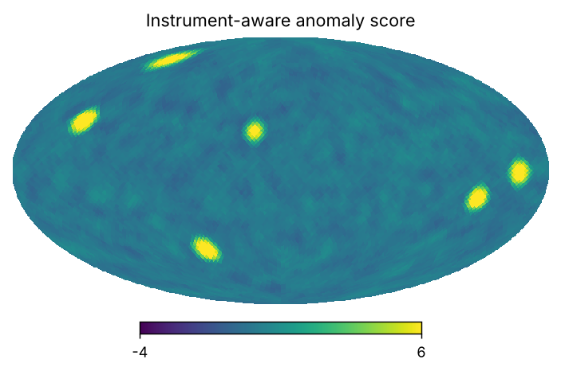
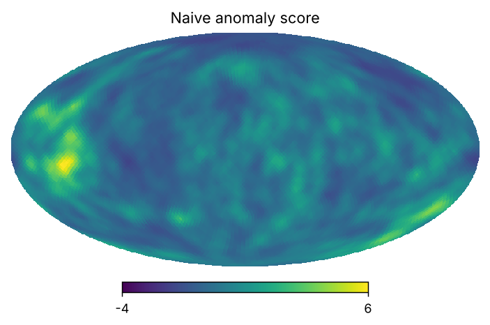

# IAVAL demo: instrument- and uncertainty-aware anomaly discovery in survey data

A small, reproducible prototype of the first stage of **IAVAL** (Intelligent Astronomical Visual Analytics Layer), a PhD research idea on discovering real anomalies in large sky surveys without being fooled by the instrument.

**Author:** Maheen Anwar (BSc Hons Astrophysics, MSc GIS, University of Karachi)

## The problem
Survey catalogues (e.g. DESI) contain structure that is not astrophysical: imaging depth and seeing change across the sky, so galaxy counts and measured colours change with them. A naive anomaly detector flags these instrument patterns as "discoveries". IAVAL asks: *what is left after the instrument and its uncertainties are accounted for, and can a human see why each candidate was flagged?*

## What this repository does
Using a **simulated** DESI-like survey with known ground truth (HEALPix `nside=32`):

1. **Pixel level.** Fits a Poisson model of galaxy counts against depth and seeing templates (with iterative clipping so real structure does not bias the fit), then scores residuals with an empirically rescaled (robust) dispersion and a matched-filter disc average.
2. **Object level.** Scores colour outliers with an error-aware chi-square, `d^T (C_int + E_i)^-1 d`, where `E_i` is each object's own measurement error and `C_int` the intrinsic covariance (observed minus mean error covariance).
3. **Explainable output.** Writes TOPCAT-ready CSVs with the expected counts from systematics, both scores and a plain-language `why` column.
4. **Evaluation.** Compares naive and aware methods against the injected truth.

## Results (simulation, seed 0; see `outputs/results.txt`)
| Level | Method | Flagged | Recovered true | False alarms |
|---|---|---|---|---|
| Pixels (6 injected overdensities, 135 pixels, 3 sigma) | naive | 239 | 9 | 229 |
| | **aware** | 234 | **135** | **0** (99 are halo pixels next to true clusters) |
| Objects (250 anomalies in 150k, 4 sigma) | naive | 224 | 206 | 18 (16 in shallowest quartile) |
| | **aware** | 211 | 205 | 6 (4 in shallowest quartile) |




## Run it
```bash
pip install -r requirements.txt
python scripts/run_demo.py      # writes outputs/ and docs/figures/
python -m pytest -q tests
```
Open `outputs/pixel_candidates_topcat.csv` in TOPCAT and plot `ra`/`dec` coloured by `aware_score`.

## Limitations (please read)
- **All data are simulated.** The systematics are known and simple (two smooth Gaussian fields acting log-linearly on counts), so these numbers show the method works in a controlled setting, not that it finds new objects in real data.
- Pixel scores use a robust empirical dispersion; the p-values are not exact significance levels.
- The intrinsic colour covariance is assumed to be a single Gaussian population.
- Nothing here has been tested on DESI DR1 yet.

## Roadmap
1. Replace the simulated catalogue with a DESI DR1 (or Legacy Surveys) extract: per-pixel depth, seeing and extinction templates from the survey's own maps.
2. Add more systematics (stellar density, extinction) and a non-linear / Gaussian-process response.
3. Extreme-deconvolution mixture for the intrinsic colour distribution.
4. Human-in-the-loop interface: reviewer labels feed back into the candidate ranking.
5. PSF-prediction work package for ground-layer AO integral-field data (MUSE/MAGPI, TIPTOP simulations).

## Layout
```
src/iaval/     synthetic.py  systematics.py  anomaly.py  export.py
scripts/       run_demo.py
tests/         test_basic.py
outputs/       results.txt, TOPCAT CSVs
docs/figures/  maps and diagnostic plots
```
## Licence
MIT
